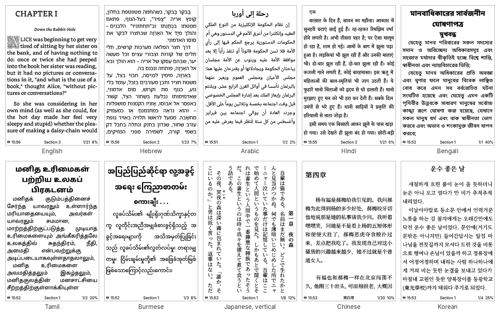

# Witch(hunt) Reader

E-reader firmware for the Xteink X3, X4 and X4 Pro, the LilyGo T5S3 Pro and the Murphy M3, based on
[crosspoint-reader](https://github.com/crosspoint-reader/crosspoint-reader), a great piece of software by Dave Allie and
others. It reads EPUB, TXT, Markdown and XTC books, lays out their CSS properly, and sets text in Latin, Cyrillic,
Greek, Hebrew, Arabic, ten Indic scripts, Burmese, Chinese, Japanese and Korean, right to left and top to bottom
included.

*Screenshots from an Xteink X3. Every script but Latin is set in a Noto font from the Font Manager.*

| Device | Chip | Touch | Notes |
| --- | --- | --- | --- |
| Xteink X4 | ESP32-C3 | no | software clock |
| Xteink X3 | ESP32-C3 | no | hardware clock |
| Xteink X4 Pro | ESP32-S3 | no | PSRAM |
| LilyGo T5S3 Pro | ESP32-S3 | yes | PSRAM |
| Murphy M3 | ESP32-S3 | yes | PSRAM, hardware clock |

## Installation

Flashing is done from the browser — no toolchain or driver install needed. Use a Chromium-based browser (Chrome, Edge, Opera) or a recent Firefox version (>151); older versions of Firefox and Safari do not support WebSerial.

1. Download `firmware.bin` for your device from the [latest release](../../releases/latest).
2. Open the [CrossPoint flash tools](https://crosspointreader.com/#flash-tools).
3. Pick your device.
4. Choose **Custom .bin** and upload the `firmware.bin` you downloaded in step 1.
5. Connect the device via USB and start the flash — pick the device's serial port when the browser asks.

For everything the reader does and how to use it, see the **[User Guide](USER_GUIDE.md)**. How it compares with
CrossPoint, feature by feature: **[Feature comparison](docs/feature-comparison.md)**.

## Languages and scripts

| Script | Languages (examples) | Layout | Fonts (Font Manager) | Hyphenation |
| --- | --- | --- | --- | --- |
| Latin, Cyrillic | English, German, French, Spanish, Vietnamese, Russian, Ukrainian, ... | full CSS layout | built in, or any TrueType, OpenType or `.cpfont` | 20 languages; English built in, the others as downloadable packs |
| Greek | Greek | full CSS layout | any TrueType or OpenType font with Greek letters; the built-in reading fonts have none | none yet |
| Hebrew | Hebrew, Yiddish, Ladino | right to left, niqqud, right-to-left page turns | Noto Sans and Serif Hebrew | none |
| Arabic script | Arabic, Persian, Urdu, Pashto, Sindhi, Kurdish | right to left, OpenType joining and marks, the end-of-ayah sign around its number | Noto Naskh Arabic, Noto Sans Arabic | none |
| Indic, ten scripts | Hindi, Marathi, Nepali, Sanskrit, Bengali, Assamese, Punjabi, Gujarati, Odia, Tamil, Telugu, Kannada, Malayalam, Sinhala | OpenType shaping: conjuncts, reph, vowel signs | Noto Sans and Serif per script | 12 languages, between syllables |
| Myanmar | Burmese, Mon, Shan, S'gaw Karen | OpenType shaping, line breaks between syllables | Noto Sans and Serif Myanmar | syllable breaks |
| Chinese, Japanese, Korean | | CJK line breaking and punctuation, ruby, emphasis dots, vertical text with tate-chu-yoko | Noto Sans and Serif CJK, per region | not needed |

Shaping is OpenType, done once when a chapter is laid out and identical to HarfBuzz on the shipped fonts; bidi follows
the Unicode algorithm, with the book's `dir`, `<bdi>`, `<bdo>`, `unicode-bidi` and page direction honoured. A book that
needs a font or a hyphenation pack it does not have offers to download it when it opens. The interface is translated
into 27 languages, and the keyboard has English, French, German, Spanish, Russian, Ukrainian, Belarusian, Kazakh,
Hebrew, Arabic and Greek layouts. StarDict dictionaries look words up in horizontal and vertical text.

## What this reader does differently

- **Speed:** pages render fast, the next ones are prepared in the background, and chapters are indexed during reading
  pauses, so the "Indexing" message shows up less often.
- **Layout:** floating figures with text wrapped around them, real tables (colspan, images inside), small caps,
  strikethrough, superscript and subscript, `line-height` and `font-size` from the book, drop caps, GIF, PNG and JPEG
  images, large-image placeholders, Markdown with headings, tables and code.
- **Memory:** where others run out, Witch Reader still works: a chapter is laid out in an arena lent from the second
  framebuffer, and hyphenation patterns come from packs on the SD card instead of the firmware image.
- **Fonts:** the Font Manager downloads TrueType, OpenType and `.cpfont` families over Wi-Fi; a book's own fonts can be
  used (Publisher Fonts); large-print sizes up to 26 pt.
- **Library:** Books, Recent, New and Authors tabs, as file names, details or a cover grid; a cover carousel on Home;
  a book information screen; global bookmarks and named starred pages; reading statistics.
- **Sync and network:** KOReader sync that lands on the exact page in both directions, OPDS catalogs, Calibre, a web
  interface with file manager and settings, WebDAV, captive-portal login, weather.
- **Device:** a clock on every board, sleep screens with an information overlay or a transparent picture over the page,
  user-defined actions for each button's single, double and long press, touch gestures on the T5S3 and Murphy.

## What this reader doesn't

* Great UI design is not necessarily/obviously not a forte of mine, so if you look for a polished look and feel, I would recommend going e.g. to [CrossInk](https://github.com/uxjulia/crossink), a great piece of work by uxJulia
* The most memory efficient reader might still be [MicroReader](https://github.com/CidVonHighwind/microreader) by CidVonHighwind
* PDF and MOBI books; Thai, Lao, Khmer and Tibetan; Nastaliq for Urdu and kashida justification for Arabic.
* Indic and Burmese book titles outside the reader draw in the font of the last book read, and are left out when it lacks
  their script; hyphenation for Greek, Romanian and Kazakh. The full list: **[Current Limitations](USER_GUIDE.md#7-current-limitations--roadmap)**.

All of them have their strengths and constraints (as has Witch reader), so they deserve a testrun before you decide which one is right for you

## Credits

This firmware stands on the work of others, crosspoint-reader above all; **[CREDITS.md](CREDITS.md)** lists the
projects, the people whose code is ported here, the vendored libraries and the fonts.

# Why this name
Originally this fork was called CrossPoint++ - it had a small userbase and then I made an honest mistake by reusing the crosspoint fork, providing ample reference in the PRs and the release notes of code origin and authorship but was losing the github commit author information in the progress when I copied code over instead of taking the tedious (and correct) way of cherrypicking the original commit and post-cleanup effort.

Another crosspoint developer approached me pointing this flaw out and I agreed to change the future integration work. What I did not care for was that persons attitude and way of communicating, and I told him so.

Then all hell broke lose, ending up in insults, harassment and plain lies in other forums without even caring for feedback (a good cause for any lawsuit for slander). So I took the repo down and just continued the development for my own benefit.

Still I wanted others to benefit from my progress, so here we are again:

Witch(hunt) Reader (name for obvious reasons) 

- So if you are one of those who felt poorly appreciated: please accept my apologies, that was never my intent, and I have taken a lot of effort to replace code / to properly attribute the origin of code or ideas
- If you are one of those who felt the need to raise a witchhunt, to lie, to libel: just go away - trolls aren't welcome here or more clearly: F*** OFF
