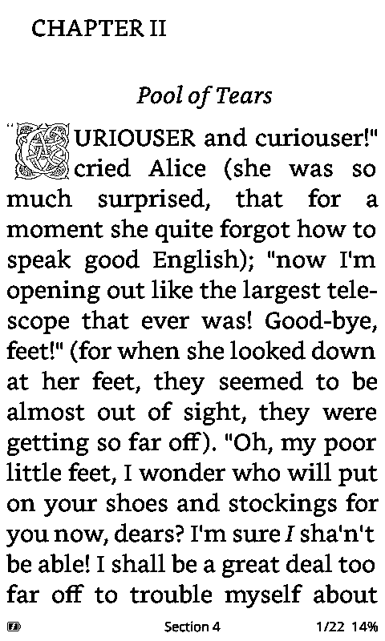
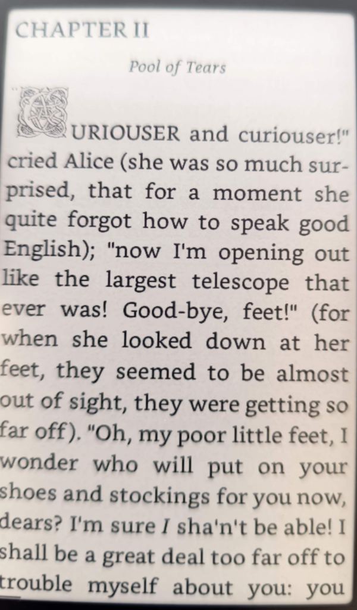
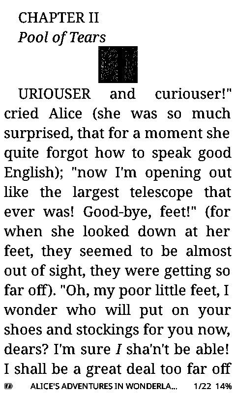
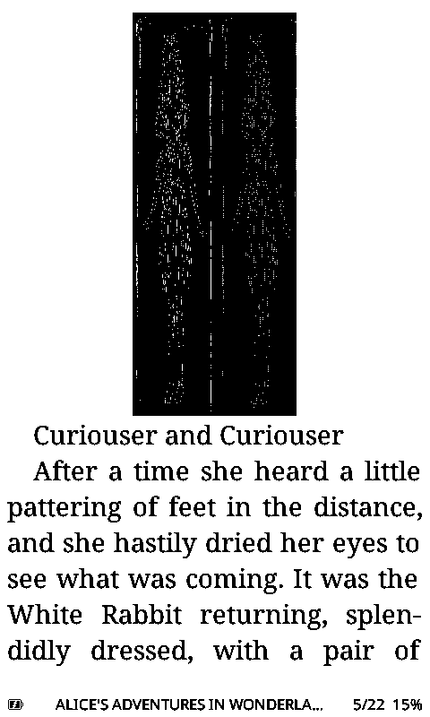
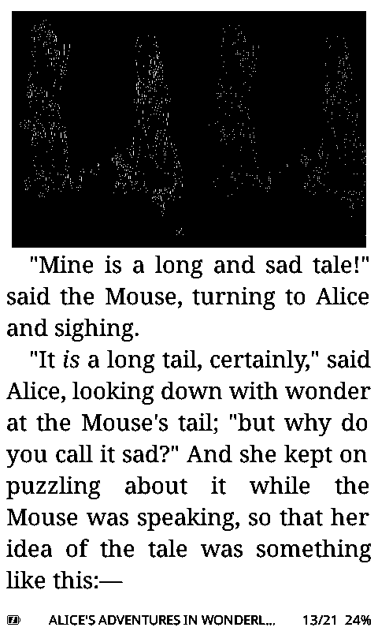
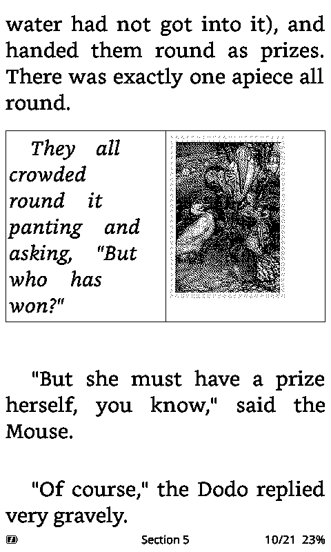
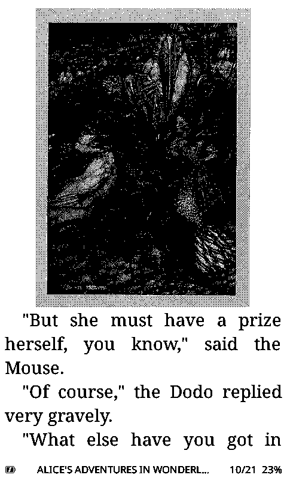

# Feature comparison with CrossPoint

A feature-by-feature comparison of **Witch Reader** against its ancestor,
**[CrossPoint Reader](https://github.com/crosspoint-reader/crosspoint-reader)**, focused on what a reader
sees and does on the device.

> **Snapshot of 2026-11-10;** verified against witchhunt-reader `2462c6cdd` (master) and
> crosspoint-reader develop `7f04359f6`. Each row was checked against the source code of both projects.
> The CrossPoint column describes its develop branch, which can be ahead of its latest release. Both
> projects change quickly, so treat this as a picture of one day, not a guarantee.
> **Updated 2026-11-11** for line and word spacing, character spacing, paragraph indent, margins, CSS
> `white-space` and `initial-letter`, boxed text, images inside a line and the image modes, checked against
> crosspoint-reader develop `fd4dbe41b`.
> **Updated 2026-11-15** on the Witch Reader side for release 2.52: Dark Mode and the Onyx BOOX Picco. The CrossPoint
> column was not checked again.
> **Updated 2026-11-16** with [speed and memory measured on the X3, the X4, the X4 Pro and the BOOX
> Picco](#measured-speed-and-memory) (Witch Reader 2.53).

## At a glance

**Witch Reader is ahead on** complex scripts and book layout. It draws bidi text in the right order on
99.9% of the test lines (CrossPoint 52.6%), joins Arabic exactly as HarfBuzz does, shapes ten Indic
scripts and Burmese, hyphenates Indic text, and sets Chinese, Japanese and Korean books in vertical
columns. It hyphenates 32 languages, uses TrueType fonts and a book's own fonts on every board, and picks
a font of the book's script by itself. In layout it adds floating images, small images inside a line of
text, grid tables of up to 8 columns with images in their cells, CSS line height, every CSS `white-space`
value, background pictures, full-resolution progressive JPEG and Markdown. While you read it prepares the
next page and the next chapters. Its Library shows covers in every tab, and it keeps reading statistics,
bookmarks across books and printed page numbers, syncs KOReader progress automatically, lets every button
press be reassigned, keeps a clock on the X4, shows the weather, logs into Wi-Fi login pages and
transfers books over the USB cable. It runs on the LilyGo T5 S3 Pro and the Murphy M3. It turns pages faster on the
X3, the X4 and the X4 Pro and as fast on the BOOX Picco, and on all four shows the page of a chapter it has not laid
out before sooner; CrossPoint reopens chapters a little sooner on the X4 and the Picco, and after such an open its
screen settles sooner on the X3, the X4 and the Picco ([measured](#measured-speed-and-memory)).

**CrossPoint is ahead on** highlights and clippings, Bluetooth page-turn remotes, library
loans (LCP) and OPDS 2 catalogs, plugins on the device, indexed title and author search, word and
character spacing, file rename and multi-delete on the device, 34 interface languages. It runs on five
boards Witch Reader does not support: the Xteink X4 Classic, Seeed reTerminal Sticky, M5Stack PaperMono,
Metalio E-Ink 4 and EEGOREAD A4.

**Since June, CrossPoint has caught up on** small caps, strikethrough, CSS font sizes and headings, drop
caps, grid tables, GIF images, transparent sleep overlays, named bookmarks, KOReader sign-up on the
device, a system information screen and grouped settings. The June summary named right-to-left text as
the one capability Witch Reader lacked; that no longer holds.

Legend: ✅ supported · ⚠️ partial or limited · ❌ not supported.

Each section ends with a "Both have" line for features the two firmwares share.

## Rendering and typography

| Feature | Witch Reader | CrossPoint |
| --- | :---: | :---: |
| Floating images, text wrapping beside them | ✅ left and right | ❌ placed as blocks |
| Tables | ✅ grid up to 8 columns, `colspan` | ⚠️ grid up to 4 columns; rows with spanning cells stack |
| Images in table cells | ✅ inside the grid | ⚠️ the row stacks into one column |
| CSS `line-height` | ✅ ("Book's Style" line spacing) | ❌ |
| CSS background pictures | ✅ drawn with their box's text | ❌ |
| Boxed text (CSS borders, shaded backgrounds) | ✅ solid, dashed, dotted and double borders up to 3 px, shading; a box cut by a page stays open at the cut | ✅ borders on all sides, gray fill |
| Images inside a line of text | ✅ icons and symbols up to twice the line height, CSS `vertical-align` | ❌ placed as blocks |
| CSS `white-space` | ✅ all six values: kept spaces, tabs and line breaks, `nowrap`, `pre-line` | ⚠️ `pre`, `pre-wrap` and `break-spaces` keep spaces; `nowrap` and `pre-line` ignored |
| CSS `initial-letter` | ✅ 2 to 6 lines, raised or sunk | ⚠️ 2 to 6 lines, no raise or sink |
| Line spacing | ✅ 90–175 % in 9 steps, or the book's `line-height` | ✅ 100–175 % in 7 steps |
| Word spacing | ❌ | ✅ 50–200 % of a space |
| Character spacing | ❌ | ✅ −2 to +2 px |
| Paragraph indent | ✅ None, 0.5 to 2 em, or the book's own | ✅ 0 to 5 spaces |
| Margins | ✅ top and bottom set apart from left and right | ⚠️ one margin for all sides |
| Progressive JPEG | ✅ full resolution | ⚠️ 1/8 resolution |
| GIF images | ✅ including interlaced | ⚠️ interlaced GIFs show a placeholder |
| Large images | ✅ placeholder until Confirm; a tall image continues on the next page | ⚠️ shrunk to one page; a Placeholder mode for all images |
| Anti-aliasing | ✅ on/off, one-pass AA on most boards, 4 text darkness levels | ✅ on/off |
| Guide dots between words | ✅ | ❌ |
| Markdown (`.md`) | ✅ headings, lists, tables, code, rules, TOC | ❌ shown as plain text |

**Both have:** small caps, strikethrough, underline, superscript and subscript, CSS font sizes and
heading sizes, drop caps, horizontal rules, page breaks, avoiding widows and orphans, bionic reading
(CrossPoint calls it Focus Reading), JPEG and PNG images, a black-and-white image mode, kerning.

## Fonts

| Feature | Witch Reader | CrossPoint |
| --- | :---: | :---: |
| Built-in reader fonts | ✅ Serif (made from Source Serif 4 Caption) and Noto Sans, 10–26 pt (20–26 pt enlarged from 18 pt) | ⚠️ Noto Sans, 12–18 pt; Noto Serif and OpenDyslexic as downloads |
| Publisher fonts (the book's embedded fonts) | ✅ body text, accents or both | ❌ |
| A book in another script picks a font of that script | ✅ uses an installed family, or offers to download one | ❌ choose the font by hand |

**Both have:** font downloads on the device, `.cpfont` fonts from the SD card in the sizes they were
built at, a font converter (ours in the web interface, CrossPoint's on its website), TrueType and
OpenType files on ESP32-S3 boards. On the X3 and X4, see [Memory](#memory).

## Languages and scripts

| Feature | Witch Reader | CrossPoint |
| --- | :---: | :---: |
| Bidi algorithm (Unicode BidiCharacterTest, 91,707 lines) | ✅ 99.8% | ⚠️ 97.2% |
| Bidi order as drawn on a book page | ✅ 99.9% | ⚠️ 52.6% |
| Arabic, Persian and Urdu letter joining | ✅ identical to HarfBuzz (100%) | ⚠️ presentation forms: 15% identical glyphs; about 88% of book words look the same, 28% of words with vowel marks |
| Right-to-left page turning | ✅ buttons, taps, swipes and progress bars follow the book | ⚠️ taps and swipes only |
| Indic scripts (Devanagari, Bengali, Tamil and 7 more) | ✅ 10 scripts shaped | ❌ not shaped (6–34% of book words right); open PR #3787 shapes them as ours does |
| Indic hyphenation | ✅ 12 languages, between syllables | ❌ |
| Indic text inside right-to-left text | ✅ | ❌ |
| Burmese (Myanmar script) | ✅ shaped; lines break between syllables | ❌ not shaped |
| Vertical Chinese, Japanese and Korean | ✅ columns right to left, with ruby, emphasis dots and tate-chu-yoko | ❌ |
| CJK emphasis dots (`text-emphasis`) | ✅ | ❌ |
| Hyphenation languages | ✅ 32: English built in, 31 as downloadable packs | ✅ 11, built in |
| Interface languages | ✅ 30, including Chinese, Japanese, Korean, Hebrew, Arabic and Persian | ✅ 34, including Arabic, Hebrew and Persian |
| CJK book titles in menus | ✅ interface packs (1.5–3.3 MB downloads) | ⚠️ only when the reader font covers CJK |
| Indic and Burmese book titles in menus | ⚠️ shaped in the last book's font, when it has the script | ❌ not shaped |
| On-screen keyboard layouts | ✅ 11, including Hebrew, Arabic and Greek | ✅ 10, including Hebrew and Arabic |

**Both have:** a Hebrew, Arabic and Persian interface (text right to left, menus laid out left to right
in both), CJK line breaking and ruby in horizontal text (in vertical text, only Witch Reader sets CJK at
all), Hebrew and Arabic titles in the menus (built into the menu fonts), Latin and Cyrillic in the built-
in fonts, other scripts through SD-card fonts.

The bidi and shaping rows were measured 2026-11-10 against the Unicode 17 BidiCharacterTest and
HarfBuzz 14.5. The Indic row counts book words drawn the same as the reference.

## Reading, library and navigation

| Feature | Witch Reader | CrossPoint |
| --- | :---: | :---: |
| Next page drawn while you read | ✅ | ⚠️ only its glyphs are prepared |
| Next chapter laid out in the background | ✅ up to about 50 pages ahead, in reading pauses | ❌ the current chapter is laid out while you read it |
| Library index | ✅ New and Authors tabs, up to 2,000 books | ✅ Added, Title and Author tabs, up to 4,096 books |
| Search | ⚠️ by file name, in one folder or all | ✅ indexed title and author search |
| Cover grid in the Library | ✅ in every tab | ❌ text lists; covers on the Home screen only |
| Folder sorting | ✅ name, date, size or type | ⚠️ folders by name only; the Library tabs sort by title, author or date added |
| File actions on the device | ✅ move, new folder, mark read, info, set as sleep image | ✅ delete several at once, rename, move |
| Book info screen for books on the card | ✅ cover, metadata, paged description | ⚠️ for OPDS catalog entries only |
| Bookmarks across all books | ✅ | ❌ per book |
| Highlights and clippings | ❌ | ✅ saved to a Kindle-style `My Clippings.txt`, synced; 256 per book on the X3/X4 |
| Reading statistics | ✅ streaks, time, pages per minute, per-book estimate | ❌ |
| Finished-book screen | ✅ next in the series, mark read, move, more by the author | ✅ up to 3 books from the same folder |
| Go to printed page | ✅ | ❌ |
| Per-book settings while reading | ✅ font, images, hyphenation, bionic reading and more | ⚠️ global text settings from the reader menu |
| Dictionary (StarDict) | ✅ installer page in the web interface; works in CJK and vertical text | ✅ looks up a selected phrase; ignores Hebrew and Arabic vowel marks |
| KOReader progress sync | ✅ exact page, register on the device | ✅ exact text position, sign up on the device, own sync server, syncs clippings |
| Automatic sync | ✅ on closing a book; also on wake, sleep and while reading on ESP32-S3 boards | ❌ manual (menu or long press) |
| Auto-rotate | ✅ follows the way the device is held (X3, Picco) | ❌ |
| Tilt page turn by a forward/back flick | ✅ as well as left/right (X3, Picco) | ❌ left/right |

**Both have:** table of contents, footnotes and links with Back through the last three, go to percent,
named bookmarks, automatic page turn, tilt page turn on the X3, screenshots, reading orientation, XTC
and TXT books, a configurable status bar, a Quick Resume sleep screen.

## System, network and input

| Feature | Witch Reader | CrossPoint |
| --- | :---: | :---: |
| Button actions | ✅ short, double and long press on every button, from one list of actions | ⚠️ front-button remap, a few long-press and Power choices |
| Touch on the reading page | ✅ every zone and gesture assignable; pinch, rotate, corner holds | ✅ tap or swipe page turns, tap links, hold to select text |
| Bluetooth page-turn remotes | ❌ | ✅ on the X3/X4 only inside a book |
| Night mode (white on black) | ✅ Dark Mode, in the reader and every menu; on a schedule, from the light panel or the Picco's slide switch on the boards with a reading light | ✅ |
| Clock on boards without a clock chip (X4) | ✅ software clock | ❌ boards with a clock chip only |
| Time zone | ✅ list of 86, or detected from the IP address | ⚠️ list with automatic daylight saving, no detection |
| Weather panel (Open-Meteo forecast) | ✅ | ❌ |
| Sleep screen: transparent overlay | ✅ PNG over the reader page | ✅ PNG or BMP over the screen or the cover |
| Sleep screen: custom images as PNG | ✅ BMP or PNG | ⚠️ BMP only (PNG for overlays) |
| Sleep screen: book info band (title, chapter, progress) | ✅ | ❌ |
| Sleep screen: image order | ✅ random or sequential | ⚠️ random only |
| Wi-Fi with a login page (hotel, train) | ✅ detects it, shows a QR code to log in | ❌ |
| OPDS catalogs | ✅ OPDS 1, search, up to 8 servers | ✅ OPDS 1 and 2, search, up to 8 servers |
| Library loans (Readium LCP) from OPDS | ❌ | ✅ official builds |
| Edit a book's title, author and cover in the web interface | ✅ | ❌ |
| Plugins | ⚠️ in the web interface only | ✅ on the device and in the web interface |
| USB transfer over the serial cable (X3, X4) | ✅ MicroReader-compatible, with its Calibre plugin | ❌ |
| USB file manager plugin ([x4-filemanager-plugin](https://github.com/jpirnay/x4-filemanager-plugin)), X3 and X4 | ✅ | ❌ |

**Both have:** web upload, WebDAV, Calibre wireless, an EPUB optimizer, settings in the web interface,
OTA and SD-card firmware updates, USB drive mode on ESP32-S3 boards (on CrossPoint, all but the Sticky), reading-light control, a system
information screen, settings grouped in categories.

## Memory

| Feature | Witch Reader | CrossPoint |
| --- | :---: | :---: |
| Large folders | ✅ indexed on the SD card, bounded RAM | ❌ every name held in RAM |
| TrueType and OpenType fonts on the X3 and X4 (no PSRAM) | ✅ including shaping for Arabic, Indic and Burmese | ⚠️ `.cpfont` only |

## Boards

| Board | Witch Reader | CrossPoint |
| --- | :---: | :---: |
| Xteink X4 (ESP32-C3) | ✅ | ✅ |
| Xteink X3 (ESP32-C3) | ✅ | ✅ |
| Xteink X4 Pro (ESP32-S3) | ✅ | ✅ |
| LilyGo T5 S3 Pro (ESP32-S3) | ✅ | ⚠️ local build profile, no release |
| Murphy M3 (ESP32-S3) | ✅ | ❌ no build profile |
| Xteink X4 Classic (ESP32-S3) | ❌ | ✅ |
| Seeed reTerminal Sticky (ESP32-S3) | ❌ | ✅ |
| M5Stack PaperMono (ESP32-S3) | ❌ | ✅ |
| Metalio E-Ink 4 (ESP32-S3) | ❌ | ✅ |
| EEGOREAD A4 (ESP32-S3) | ❌ | ✅ |
| Onyx BOOX Picco (ESP32-S3) | ✅ on Witch Reader's partition table or Onyx's | ✅ |
| Touch screen | ✅ X4 Pro, T5 S3 Pro, Murphy M3, BOOX Picco | ✅ X4 Pro, Sticky, PaperMono and others |

Want your device supported? Consider donating one: support for a board needs the board on the desk. [Open an issue](https://github.com/jpirnay/witchhunt-reader/issues) to arrange it.

## ESP32-C3 boards (X3, X4)

The Xteink X3 and X4 run on an ESP32-C3 with about 380 KB of RAM and no PSRAM; the X4 Pro, T5 S3 Pro, Murphy M3 and
BOOX Picco have an ESP32-S3 with PSRAM. In Witch Reader the reading features are the same code on both chips: TrueType fonts,
Publisher Fonts, every script with its shaping and bidi, vertical CJK and all 32 hyphenation languages work on the X3
and X4, and the screenshots in the README come from an X3. What the C3 boards miss is mostly hardware: no touch
screen, no reading light, no USB drive (the C3 has no USB OTG) and, on the X4, no clock chip. One feature is left out
for memory: KOReader sync in the background. CrossPoint keeps TrueType fonts, its Cover Grid home theme and part of
its clippings and Bluetooth support for boards with PSRAM. The X3 and X4 also have things most S3 boards lack: tilt
page turns and auto-rotate (X3; of the S3 boards only the Picco has the motion sensor), the Sunlight Fading Fix, and USB
Transfer over the serial cable.

### The same on the X3 and X4

| Feature | Witch Reader C3 | Witch Reader S3 | CrossPoint C3 | CrossPoint S3 |
| --- | :---: | :---: | :---: | :---: |
| TrueType and OpenType fonts | ✅ glyph store in flash | ✅ | ❌ `.cpfont` only | ✅ |
| Publisher Fonts (the book's own fonts) | ✅ | ✅ | ❌ | ❌ |
| Shaping: Arabic script, 10 Indic scripts, Burmese | ✅ | ✅ | ⚠️ Arabic presentation forms only | ⚠️ Arabic presentation forms only |
| Bidi (Hebrew, Arabic, mixed lines) | ✅ | ✅ | ⚠️ as on S3 | ⚠️ 52.6% of book lines right |
| Vertical CJK columns | ✅ | ✅ | ❌ | ❌ |
| Ruby, emphasis dots, tate-chu-yoko in columns | ✅ | ✅ | ❌ | ❌ |
| Dictionary in vertical text | ✅ | ✅ | ❌ | ❌ |
| CJK reading fonts | ✅ TrueType Noto CJK | ✅ | ⚠️ `.cpfont` only | ✅ TTF, OTF, TTC or `.cpfont` |
| CJK book titles in menus | ✅ interface packs | ✅ | ⚠️ only with a CJK reader font | ⚠️ only with a CJK reader font |
| Hyphenation | ✅ 32 languages, a pack copied to flash once | ✅ 32 languages, read at book open | ✅ 11 built in | ✅ 11 built in |
| Next chapter laid out in reading pauses | ✅ up to about 50 pages ahead | ✅ | ❌ | ❌ |

### What the X3 and X4 do not get

| Feature | Witch Reader C3 | Witch Reader S3 | CrossPoint C3 | CrossPoint S3 |
| --- | :---: | :---: | :---: | :---: |
| Touch screen | ❌ no digitiser | ✅ two fingers on the X4 Pro, T5 S3 and BOOX Picco | ❌ | ✅ X4 Pro, PaperMono and others |
| Reading light | ❌ none fitted | ✅ warmth on the X4 Pro | ❌ | ✅ warmth on the X4 Pro |
| USB Drive | ❌ the C3 has no USB OTG | ✅ | ❌ | ✅ all but the Sticky |
| USB Transfer over the serial cable | ✅ | ❌ USB Drive instead | ❌ | ❌ |
| Clock | ⚠️ X3 chip; X4 software clock, uses more battery | ✅ chip on all three | ⚠️ X3 only | ✅ boards with a clock chip |
| KOReader sync in the background | ⚠️ on closing a book only | ✅ also on wake, sleep, while reading | ❌ manual | ❌ manual |
| Bluetooth page-turn remotes | ❌ | ❌ | ⚠️ in a book only, paused while a chapter indexes | ✅ |
| Highlights and clippings | ❌ | ❌ | ⚠️ 256 per book | ✅ 1,024 per book |
| Cover Grid home theme | ✅ cover themes on both | ✅ | ❌ needs PSRAM | ✅ |
| Font area in flash | ⚠️ 3.0 MB (384 KB hold hyphenation) | ✅ 3.4 MB | — | — |
| Pages with large pictures when memory is short | ⚠️ coarser picture, fewer book fonts, a box or a restart as a last resort | ✅ PSRAM | not checked | not checked |

Checked in the code of both firmwares (Witch Reader 2820c9562, CrossPoint develop 7f04359f6); the effect of the
smaller font area on large CJK books was not measured.

## Measured speed and memory

> Measured on one Xteink X3, one X4, one X4 Pro and one BOOX Picco against CrossPoint develop `36b9430e`
> (2026-11-15) with its serial test API (PR #4458) and one unmerged fix, measured 2026-11-15 and 2026-11-16. Witch
> Reader on the X3 and the Picco: master `fbee8fa6f`, a development build after 2.53, measured 2026-11-17. On the X4
> and the X4 Pro: Witch Reader 2.53, measured 2026-11-15 and 2026-11-16 (the X4's rows marked † again on 2026-11-17
> with two later fixes; the X4 Pro's page turns on 2.52 and again after each 2.53 change, within 10 ms each time).
> All builds are development builds. One script drove both firmwares through their serial test APIs: a press, then a
> wait until the screen has settled, which includes a 250 ms quiet window on both. Same book (*The Odyssey*, Book IV,
> 8,077 words), the same settings as far as both have them: Noto Sans 14 pt (the one built-in font both have), 38 px
> line pitch, justified, hyphenation on, a full refresh every 15 pages. Medians of 30 page turns and of 3 to 5 opens.
> Opens without a cache and turns into the next chapter ran three times each, except CrossPoint's on the X3 and the
> X4 Pro (once each). "Page on screen" and "page complete" come from each firmware's log, for both alike: the panel
> refresh that shows the page, and the one that puts its AA on the panel. The screen settles 0.3 to 0.6 s later
> (CrossPoint on the X4 Pro: 1.3 s later, while it lays out more pages). "Chapter laid out" is when the layout of the
> whole chapter is done.

**X3**

| | Witch Reader | CrossPoint |
| --- | :---: | :---: |
| Page turn, no AA | 0.93 s | 1.02 s |
| Page turn, AA in two passes | 1.37 s | 1.77 s |
| Page turn, AA in one pass | 1.08 s | ❌ not available |
| Turn into the next chapter, AA in two passes | 1.72 s ¹ | 1.94 s |
| Reopen a chapter, cache kept, AA in two passes | 2.4 s | 4.4 s |
| Open a chapter, cache deleted: page on screen, no AA | 3.4 s | 5.1 s |
| Open a chapter, cache deleted: page complete, AA in two passes | 6.6 s | 6.0 s |
| Open a chapter, cache deleted: chapter laid out, AA in two passes | 6.1 s | not measured ² |
| Boot to Home | 4.6 s ³ | 6.0 s |
| Free heap in the reader at rest (largest block) | 69 KB (55 KB) | 103–143 KB (94–115 KB) |
| Lowest free heap since boot | 45.5 KB | 30.8 KB |

¹ The next chapter was already laid out, during the last pages of this one. The turn waited for the layout of the
chapter after it, which had started 0.3 s before the press. The same turn without that (one page back, then on):
1.56 s.
² CrossPoint shows the page once its first 8 or 9 pages are laid out and lays out the rest as the pages are turned to,
not while the page is up, so its log gives no time for the whole chapter.
³ With the tester's own settings and 24 font families on the card; 4.4 s with the benchmark settings.

Witch Reader turns pages, turns into the next chapter and reopens a chapter faster in every mode, and shows the first
page of a chapter it has not laid out 1.7 s sooner without AA. With AA, CrossPoint completes that page sooner, by
0.6 s: it adds the AA as soon as the page is on screen. On the X3 Witch Reader adds the AA to that page once the whole
chapter is laid out, 0.4 s after the end of the layout.

At rest, CrossPoint has more of the X3's heap free, because Witch Reader keeps a second 52 KB framebuffer. It holds
the pre-rendered next page and the page under the AA planes, and chapter builds and cover decodes borrow it as
scratch. CrossPoint runs with one framebuffer and allocates a 48 KB copy of the page for each AA page. At the lowest
point of its run, CrossPoint had less heap free than Witch Reader.

**X4**

| | Witch Reader 2.53 | CrossPoint |
| --- | :---: | :---: |
| Page turn, no AA | 1.01 s | 1.17 s |
| Page turn, AA in two passes | 1.29 s | 1.41 s |
| Page turn, AA in one pass | 1.05 s | ❌ not available on the X4 |
| Turn into the next chapter, AA in two passes | 1.96 s † ⁴ | 2.02 s |
| Reopen a chapter, cache kept, AA in two passes | 3.2 s | 3.0 s |
| Open a chapter, cache deleted: page on screen, no AA | 4.2 s † | 4.6 s |
| Open a chapter, cache deleted: page complete, AA in two passes | 7.0 s † | 5.0 s |
| Open a chapter, cache deleted: chapter laid out, AA in two passes | 6.6 s † | not measured ² |
| Boot to Home | 3.9 s | 3.9 s |
| Free heap in the reader at rest (largest block) | 80 KB (66 KB) | 150 KB (115 KB) |
| Lowest free heap since boot | 53.2 KB † | 48.2 KB |

† Measured again on 2026-11-17 with two fixes the bench led to, which come with the release after 2.53: a first open
lays its chapter out in the borrowed framebuffer from the start (#802), and the next chapter is laid out while you
read the last pages of this one (#805). 2.53 itself: 3.7 s, 5.0 s, 7.8 s, 7.5 s and 23.0 KB.
⁴ The new chapter's page is on screen after 1.0 s. Into a chapter laid out already: 1.76 s against 1.53 s.

On the X4 Witch Reader turns pages faster in every mode, shows the page of a chapter it has not laid out before
sooner, and turns into the next chapter as fast. CrossPoint reopens a chapter a little sooner, and after an open
without a cache it completes the page with its AA about 2 s sooner: it adds the AA once part of the chapter is laid
out, Witch Reader once the whole chapter is. At rest CrossPoint has more heap free, for the reason given under the X3.

**X4 Pro**

| | Witch Reader 2.53 | CrossPoint |
| --- | :---: | :---: |
| Page turn, no AA | 1.17 s | 1.22 s |
| Page turn, AA in one pass | 1.36 s | 1.75 s |
| Page turn, AA in two passes | 1.91 s | ❌ not offered on the X4 Pro |
| Reopen a chapter, cache kept, AA (each firmware's default) | 3.5 s | 4.1 s |
| Open a chapter, cache deleted: page on screen, no AA | 3.7 s | 4.9 s |
| Open a chapter, cache deleted: page complete, AA | 5.0 s in two passes, 5.0 s in one | 8.7 s |
| Open a chapter, cache deleted: chapter laid out, AA | 4.5 s | not measured ⁵ |

⁵ CrossPoint went on laying out the chapter while the page was up; it had 23 pages laid out when the run left the
reader 1.5 s after the screen had settled, so its log gives no time for the whole chapter.

AA is each firmware's default on the board: two passes on the X3 for both; on the X4 Pro Witch Reader ships two
passes (one pass is a setting) and CrossPoint always uses one pass. On the X4 Pro Witch Reader opens a chapter without
a cache faster in every mode, and turns AA pages faster; without AA the two turn pages alike. Without AA CrossPoint
reopened a chapter slightly faster (2.6 s against 2.8 s, measured before the last of 2.53's changes to opening a
book). Witch Reader's default binds "skip 10 pages" to a double press of the page keys, which makes every single
press wait out the double-press window (about 0.33 s on the X3); it was set to Ignore for these runs.

**BOOX Picco**

| | Witch Reader | CrossPoint |
| --- | :---: | :---: |
| Page turn, no AA | 1.12 s | 1.12 s |
| Page turn, AA in one pass | 1.14 s | ❌ not available on the Picco |
| Page turn, AA in two passes | 1.64 s | 1.62 s |
| Turn into the next chapter, AA in two passes | 1.69 s | 1.61 s |
| Reopen a chapter, cache kept, AA in two passes | 1.73 s | 1.56 s |
| Open a chapter, cache deleted: page on screen, no AA | 1.31 s | 1.59 s |
| Open a chapter, cache deleted: page complete, AA in two passes | 1.84 s | 2.04 s |
| Open a chapter, cache deleted: chapter laid out, AA in two passes | 2.8 s | 3.9 s |
| Boot to Home | 3.4 s | 3.3 s |
| Free internal heap in the reader at rest | 173 KB | 165 KB |
| Lowest free internal heap since boot | 150 KB | 127 KB |

Both firmwares draw AA in two passes on the Picco by default; Witch Reader's One-Pass Anti-Aliasing is a setting
there, and CrossPoint has no one-pass path for this panel. The two turn pages alike, with or without AA. After an open
without a cache Witch Reader shows the page sooner, completes it with its AA sooner and has the whole chapter laid out
a second sooner: it adds the AA to the page while the rest of the chapter is laid out. CrossPoint shows the page once
part of the chapter is laid out, adds the AA, and lays out the rest while the page is up. CrossPoint turns into the
next chapter, reopens a chapter and boots sooner, by 0.08, 0.17 and 0.13 s: on a reopen Witch Reader's page and its AA
reach the panel 0.13 and 0.16 s later. Witch Reader keeps more of the internal heap free.

## Rendering comparisons

Rendering examples from [Alice in Wonderland](https://www.gutenberg.org/ebooks/28885).

> These screenshots were taken on 2026-06-16 for the original README and have not been retaken. Both
> firmwares have changed since; the tables above give the current state.

| Item 	|Witch Reader |	Micro Reader 1) 2) | CrossPoint |	
| --- | --- | --- | --- | 
| Floating images 1 |   |  |    |    
| Floating images 2 |   |    |    |    
| CSS Rendering |     |   |  |    
| Graphics |   |   |   |    
| Images in tables |   |   |   |    

1) Apologies for the poor image quality of the microreader screenshots, i needed to make photos with my mobile, as I couldn't figure out how to create screenshots from within the reader

2) The Rendering of the Mouse poem in MicroReader is even more refined, it manages to deal with different font sizes, too
