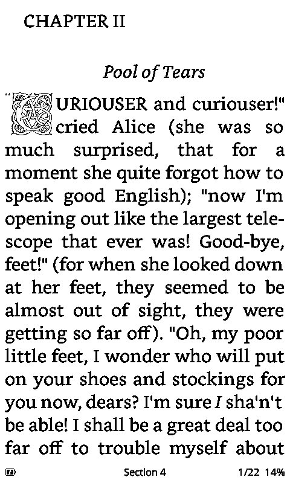
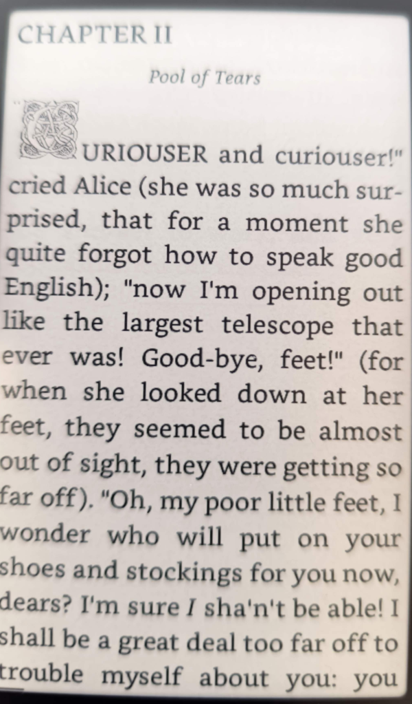
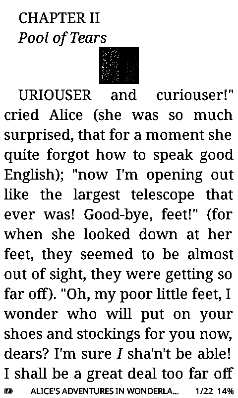
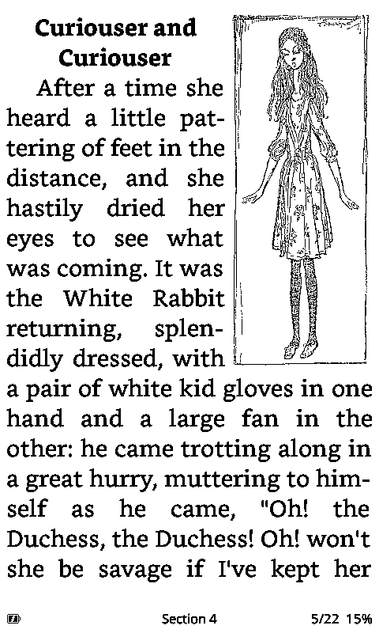
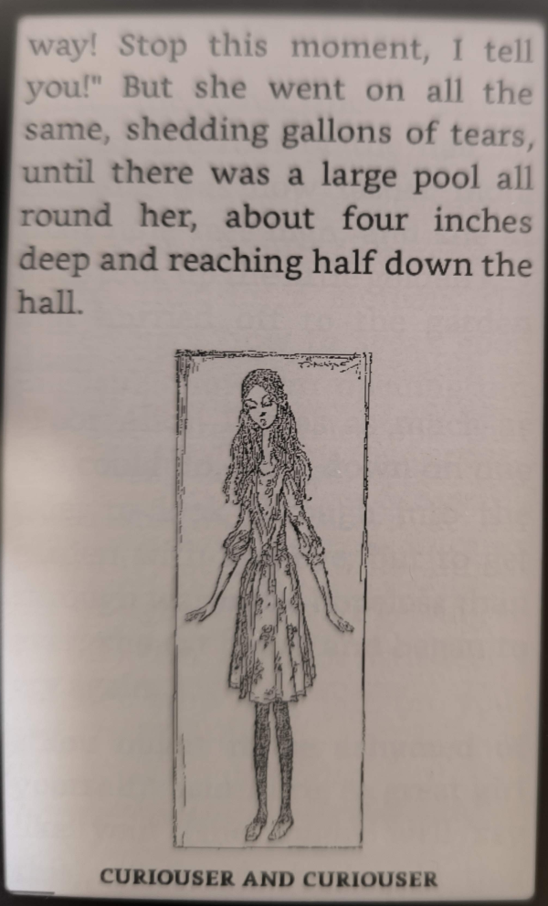
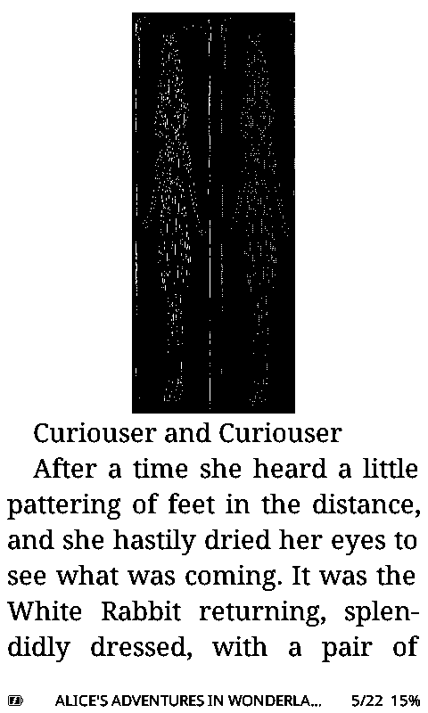
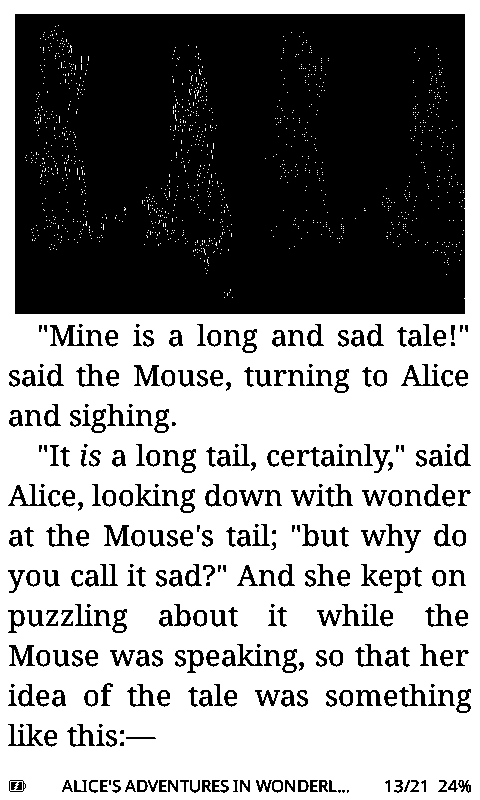
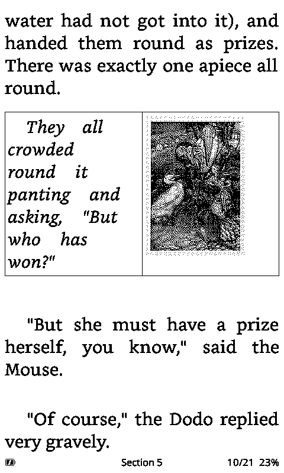
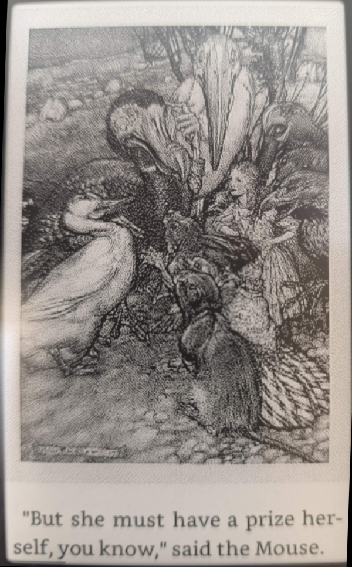
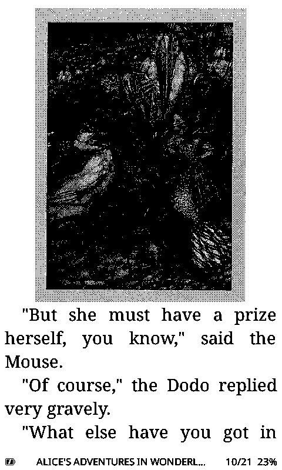

# Feature comparison with CrossPoint

A feature-by-feature comparison of **Witch Reader** against its ancestor,
**[CrossPoint Reader](https://github.com/crosspoint-reader/crosspoint-reader)**, focused on what a reader
sees and does on the device.

> **Snapshot of 2026-11-10;** verified against witchhunt-reader `2462c6cdd` (master) and
> crosspoint-reader develop `7f04359f6`. Each row was checked against the source code of both projects.
> The CrossPoint column describes its develop branch, which can be ahead of its latest release. Both
> projects change quickly, so treat this as a picture of one day, not a guarantee.

## At a glance

**Witch Reader is ahead on** complex scripts and book layout. It draws bidi text in the right order on
99.9% of the test lines (CrossPoint 52.6%), joins Arabic exactly as HarfBuzz does, shapes ten Indic
scripts and Burmese, hyphenates Indic text, and sets Chinese, Japanese and Korean books in vertical
columns. It hyphenates 32 languages, uses TrueType fonts and a book's own fonts on every board, and
picks a font of the book's script by itself. In layout it adds floating images, grid tables of up to
8 columns with images in their cells, CSS line height, background pictures, full-resolution progressive
JPEG and Markdown. While you read it prepares the next page and the next chapters. Its Library shows
covers in every tab, and it keeps reading statistics, bookmarks across books and printed page numbers,
syncs KOReader progress automatically, lets every button press be reassigned, keeps a clock on the X4,
shows the weather, logs into Wi-Fi login pages and transfers books over the USB cable. It runs on the
LilyGo T5 S3 Pro and the Murphy M3.

**CrossPoint is ahead on** highlights and clippings, Bluetooth page-turn remotes, night mode, library
loans (LCP) and OPDS 2 catalogs, plugins on the device, indexed title and author search, boxed text with
borders and shading, file rename and multi-delete on the device, 34 interface languages with a
right-to-left interface in Arabic, Hebrew and Persian. It runs on six boards Witch Reader does not support: the Xteink X4 Classic,
Seeed reTerminal Sticky, M5Stack PaperMono, Metalio E-Ink 4, EEGOREAD A4 and Onyx BOOX Picco.

**Since June, CrossPoint has caught up on** small caps, strikethrough, CSS font sizes and headings, drop
caps, grid tables, GIF images, transparent sleep overlays, named bookmarks, KOReader sign-up on the
device, a system information screen and grouped settings. The June summary named right-to-left text as
the one capability Witch Reader lacked; that no longer holds.

Legend: ✅ supported · ⚠️ partial or limited · ❌ not supported.

Each section ends with a "Both have" line for features the two firmwares share.

## Rendering and typography

| Feature | Witch Reader | CrossPoint |
| --- | :---: | :---: |
| Floating images, text wrapping beside them | ✅ left and right | ❌ placed as blocks |
| Tables | ✅ grid up to 8 columns, `colspan` | ⚠️ grid up to 4 columns; rows with spanning cells stack |
| Images in table cells | ✅ inside the grid | ⚠️ the row stacks into one column |
| CSS `line-height` | ✅ ("Book's Style" line spacing) | ❌ |
| CSS background pictures | ✅ drawn with their box's text | ❌ |
| Boxed text (CSS borders, shaded backgrounds) | ❌ rules and table lines only | ✅ borders on all sides, gray fill |
| Progressive JPEG | ✅ full resolution | ⚠️ 1/8 resolution |
| GIF images | ✅ including interlaced | ⚠️ interlaced GIFs show a placeholder |
| Large images | ✅ placeholder until Confirm; a tall image continues on the next page | ⚠️ shrunk to one page; a Placeholder mode for all images |
| Anti-aliasing | ✅ on/off, one-pass AA on most boards, 4 text darkness levels | ✅ on/off |
| Guide dots between words | ✅ | ❌ |
| Markdown (`.md`) | ✅ headings, lists, tables, code, rules, TOC | ❌ shown as plain text |

**Both have:** small caps, strikethrough, underline, superscript and subscript, CSS font sizes and
heading sizes, drop caps, horizontal rules, page breaks, avoiding widows and orphans, bionic reading
(CrossPoint calls it Focus Reading), JPEG and PNG images, kerning.

## Fonts

| Feature | Witch Reader | CrossPoint |
| --- | :---: | :---: |
| Built-in reader fonts | ✅ Bookerly and Noto Sans, 10–26 pt (20–26 pt enlarged from 18 pt) | ⚠️ Noto Sans, 12–18 pt; Noto Serif and OpenDyslexic as downloads |
| Publisher fonts (the book's embedded fonts) | ✅ body text, accents or both | ❌ |
| A book in another script picks a font of that script | ✅ uses an installed family, or offers to download one | ❌ choose the font by hand |

**Both have:** font downloads on the device, `.cpfont` fonts from the SD card in the sizes they were
built at, a font converter (ours in the web interface, CrossPoint's on its website), TrueType and
OpenType files on ESP32-S3 boards. On the X3 and X4, see [Memory](#memory).

## Languages and scripts

| Feature | Witch Reader | CrossPoint |
| --- | :---: | :---: |
| Bidi algorithm (Unicode BidiCharacterTest, 91,707 lines) | ✅ 99.8% | ⚠️ 97.2% |
| Bidi order as drawn on a book page | ✅ 99.9% | ⚠️ 52.6% |
| Arabic, Persian and Urdu letter joining | ✅ identical to HarfBuzz (100%) | ⚠️ presentation forms: 15% identical glyphs; about 88% of book words look the same, 28% of words with vowel marks |
| Right-to-left page turning | ✅ buttons, taps, swipes and progress bars follow the book | ⚠️ taps and swipes only |
| Indic scripts (Devanagari, Bengali, Tamil and 7 more) | ✅ 10 scripts shaped | ❌ not shaped (6–34% of book words right); open PR #3787 shapes them as ours does |
| Indic hyphenation | ✅ 12 languages, between syllables | ❌ |
| Indic text inside right-to-left text | ✅ | ❌ |
| Burmese (Myanmar script) | ✅ shaped; lines break between syllables | ❌ not shaped |
| Vertical Chinese, Japanese and Korean | ✅ columns right to left, with ruby, emphasis dots and tate-chu-yoko | ❌ |
| CJK emphasis dots (`text-emphasis`) | ✅ | ❌ |
| Hyphenation languages | ✅ 32: English built in, 31 as downloadable packs | ✅ 11, built in |
| Interface languages | ✅ 27, including Chinese, Japanese and Korean | ✅ 34, including Arabic, Hebrew and Persian |
| Right-to-left interface | ❌ | ✅ Arabic, Hebrew, Persian |
| CJK book titles in menus | ✅ interface packs (1.5–3.3 MB downloads) | ⚠️ only when the reader font covers CJK |
| Indic and Burmese book titles in menus | ⚠️ shaped in the last book's font, when it has the script | ❌ not shaped |
| On-screen keyboard layouts | ✅ 11, including Hebrew, Arabic and Greek | ✅ 10, including Hebrew and Arabic |

**Both have:** CJK line breaking and ruby in horizontal text (in vertical text, only Witch Reader sets
CJK at all), Hebrew and Arabic titles in the menus (built into the menu fonts), Latin and Cyrillic in the
built-in fonts, other scripts through SD-card fonts.

The bidi and shaping rows were measured 2026-11-10 against the Unicode 17 BidiCharacterTest and
HarfBuzz 14.5. The Indic row counts book words drawn the same as the reference.

## Reading, library and navigation

| Feature | Witch Reader | CrossPoint |
| --- | :---: | :---: |
| Next page drawn while you read | ✅ | ⚠️ only its glyphs are prepared |
| Next chapter laid out in the background | ✅ up to about 50 pages ahead, in reading pauses | ❌ the current chapter is laid out while you read it |
| Library index | ✅ New and Authors tabs, up to 2,000 books | ✅ Added, Title and Author tabs, up to 4,096 books |
| Search | ⚠️ by file name, in one folder or all | ✅ indexed title and author search |
| Cover grid in the Library | ✅ in every tab | ❌ text lists; covers on the Home screen only |
| Folder sorting | ✅ name, date, size or type | ⚠️ folders by name only; the Library tabs sort by title, author or date added |
| File actions on the device | ✅ move, new folder, mark read, info, set as sleep image | ✅ delete several at once, rename, move |
| Book info screen for books on the card | ✅ cover, metadata, paged description | ⚠️ for OPDS catalog entries only |
| Bookmarks across all books | ✅ | ❌ per book |
| Highlights and clippings | ❌ | ✅ saved to a Kindle-style `My Clippings.txt`, synced; 256 per book on the X3/X4 |
| Reading statistics | ✅ streaks, time, pages per minute, per-book estimate | ❌ |
| Finished-book screen | ✅ next in the series, mark read, move, more by the author | ✅ up to 3 books from the same folder |
| Go to printed page | ✅ | ❌ |
| Per-book settings while reading | ✅ font, images, hyphenation, bionic reading and more | ⚠️ global text settings from the reader menu |
| Dictionary (StarDict) | ✅ installer page in the web interface; works in CJK and vertical text | ✅ looks up a selected phrase; ignores Hebrew and Arabic vowel marks |
| KOReader progress sync | ✅ exact page, register on the device | ✅ exact text position, sign up on the device, own sync server, syncs clippings |
| Automatic sync | ✅ on closing a book; also on wake, sleep and while reading on ESP32-S3 boards | ❌ manual (menu or long press) |

**Both have:** table of contents, footnotes and links with Back through the last three, go to percent,
named bookmarks, automatic page turn, tilt page turn on the X3, screenshots, reading orientation, XTC
and TXT books, a configurable status bar, a Quick Resume sleep screen.

## System, network and input

| Feature | Witch Reader | CrossPoint |
| --- | :---: | :---: |
| Button actions | ✅ short, double and long press on every button, from one list of actions | ⚠️ front-button remap, a few long-press and Power choices |
| Touch on the reading page | ✅ every zone and gesture assignable; pinch, rotate, corner holds | ✅ tap or swipe page turns, tap links, hold to select text |
| Bluetooth page-turn remotes | ❌ | ✅ on the X3/X4 only inside a book |
| Night mode (white on black) | ❌ | ✅ |
| Clock on boards without a clock chip (X4) | ✅ software clock | ❌ boards with a clock chip only |
| Time zone | ✅ list of 86, or detected from the IP address | ⚠️ list with automatic daylight saving, no detection |
| Weather panel (Open-Meteo forecast) | ✅ | ❌ |
| Sleep screen: transparent overlay | ✅ PNG over the reader page | ✅ PNG or BMP over the screen or the cover |
| Sleep screen: custom images as PNG | ✅ BMP or PNG | ⚠️ BMP only (PNG for overlays) |
| Sleep screen: book info band (title, chapter, progress) | ✅ | ❌ |
| Sleep screen: image order | ✅ random or sequential | ⚠️ random only |
| Wi-Fi with a login page (hotel, train) | ✅ detects it, shows a QR code to log in | ❌ |
| OPDS catalogs | ✅ OPDS 1, search, up to 8 servers | ✅ OPDS 1 and 2, search, up to 8 servers |
| Library loans (Readium LCP) from OPDS | ❌ | ✅ official builds |
| Edit a book's title, author and cover in the web interface | ✅ | ❌ |
| Plugins | ⚠️ in the web interface only | ✅ on the device and in the web interface |
| USB transfer over the serial cable (X3, X4) | ✅ MicroReader-compatible, with its Calibre plugin | ❌ |
| USB file manager plugin ([x4-filemanager-plugin](https://github.com/jpirnay/x4-filemanager-plugin)), X3 and X4 | ✅ | ❌ |

**Both have:** web upload, WebDAV, Calibre wireless, an EPUB optimizer, settings in the web interface,
OTA and SD-card firmware updates, USB drive mode on ESP32-S3 boards (on CrossPoint, all but the Sticky), reading-light control, a system
information screen, settings grouped in categories.

## Memory

| Feature | Witch Reader | CrossPoint |
| --- | :---: | :---: |
| Large folders | ✅ indexed on the SD card, bounded RAM | ❌ every name held in RAM |
| TrueType and OpenType fonts on the X3 and X4 (no PSRAM) | ✅ including shaping for Arabic, Indic and Burmese | ⚠️ `.cpfont` only |

## Boards

| Board | Witch Reader | CrossPoint |
| --- | :---: | :---: |
| Xteink X4 (ESP32-C3) | ✅ | ✅ |
| Xteink X3 (ESP32-C3) | ✅ | ✅ |
| Xteink X4 Pro (ESP32-S3) | ✅ | ✅ |
| LilyGo T5 S3 Pro (ESP32-S3) | ✅ | ⚠️ local build profile, no release |
| Murphy M3 (ESP32-S3) | ✅ | ❌ no build profile |
| Xteink X4 Classic (ESP32-S3) | ❌ | ✅ |
| Seeed reTerminal Sticky (ESP32-S3) | ❌ | ✅ |
| M5Stack PaperMono (ESP32-S3) | ❌ | ✅ |
| Metalio E-Ink 4 (ESP32-S3) | ❌ | ✅ |
| EEGOREAD A4 (ESP32-S3) | ❌ | ✅ |
| Onyx BOOX Picco (ESP32-S3) | ❌ | ✅ |
| Touch screen | ✅ X4 Pro, T5 S3 Pro, Murphy M3 | ✅ X4 Pro, Sticky, PaperMono and others |

Want your device supported? Consider donating one: support for a board needs the board on the desk. [Open an issue](https://github.com/jpirnay/witchhunt-reader/issues) to arrange it.

## ESP32-C3 boards (X3, X4)

The Xteink X3 and X4 run on an ESP32-C3 with about 380 KB of RAM and no PSRAM; the X4 Pro, T5 S3 Pro and Murphy M3
have an ESP32-S3 with PSRAM. In Witch Reader the reading features are the same code on both chips: TrueType fonts,
Publisher Fonts, every script with its shaping and bidi, vertical CJK and all 32 hyphenation languages work on the X3
and X4, and the screenshots in the README come from an X3. What the C3 boards miss is mostly hardware: no touch
screen, no reading light, no USB drive (the C3 has no USB OTG) and, on the X4, no clock chip. One feature is left out
for memory: KOReader sync in the background. CrossPoint keeps TrueType fonts, its Cover Grid home theme and part of
its clippings and Bluetooth support for boards with PSRAM. The X3 and X4 also have things the S3 boards lack: tilt
page turns (X3), the Sunlight Fading Fix, and USB Transfer over the serial cable.

### The same on the X3 and X4

| Feature | Witch Reader C3 | Witch Reader S3 | CrossPoint C3 | CrossPoint S3 |
| --- | :---: | :---: | :---: | :---: |
| TrueType and OpenType fonts | ✅ glyph store in flash | ✅ | ❌ `.cpfont` only | ✅ |
| Publisher Fonts (the book's own fonts) | ✅ | ✅ | ❌ | ❌ |
| Shaping: Arabic script, 10 Indic scripts, Burmese | ✅ | ✅ | ⚠️ Arabic presentation forms only | ⚠️ Arabic presentation forms only |
| Bidi (Hebrew, Arabic, mixed lines) | ✅ | ✅ | ⚠️ as on S3 | ⚠️ 52.6% of book lines right |
| Vertical CJK columns | ✅ | ✅ | ❌ | ❌ |
| Ruby, emphasis dots, tate-chu-yoko in columns | ✅ | ✅ | ❌ | ❌ |
| Dictionary in vertical text | ✅ | ✅ | ❌ | ❌ |
| CJK reading fonts | ✅ TrueType Noto CJK | ✅ | ⚠️ `.cpfont` only | ✅ TTF, OTF, TTC or `.cpfont` |
| CJK book titles in menus | ✅ interface packs | ✅ | ⚠️ only with a CJK reader font | ⚠️ only with a CJK reader font |
| Hyphenation | ✅ 32 languages, a pack copied to flash once | ✅ 32 languages, read at book open | ✅ 11 built in | ✅ 11 built in |
| Next chapter laid out in reading pauses | ✅ up to about 50 pages ahead | ✅ | ❌ | ❌ |

### What the X3 and X4 do not get

| Feature | Witch Reader C3 | Witch Reader S3 | CrossPoint C3 | CrossPoint S3 |
| --- | :---: | :---: | :---: | :---: |
| Touch screen | ❌ no digitiser | ✅ two fingers on the X4 Pro and T5 S3 | ❌ | ✅ X4 Pro, PaperMono and others |
| Reading light | ❌ none fitted | ✅ warmth on the X4 Pro | ❌ | ✅ warmth on the X4 Pro |
| USB Drive | ❌ the C3 has no USB OTG | ✅ | ❌ | ✅ all but the Sticky |
| USB Transfer over the serial cable | ✅ | ❌ USB Drive instead | ❌ | ❌ |
| Clock | ⚠️ X3 chip; X4 software clock, uses more battery | ✅ chip on all three | ⚠️ X3 only | ✅ boards with a clock chip |
| KOReader sync in the background | ⚠️ on closing a book only | ✅ also on wake, sleep, while reading | ❌ manual | ❌ manual |
| Bluetooth page-turn remotes | ❌ | ❌ | ⚠️ in a book only, paused while a chapter indexes | ✅ |
| Highlights and clippings | ❌ | ❌ | ⚠️ 256 per book | ✅ 1,024 per book |
| Cover Grid home theme | ✅ cover themes on both | ✅ | ❌ needs PSRAM | ✅ |
| Font area in flash | ⚠️ 3.0 MB (384 KB hold hyphenation) | ✅ 3.4 MB | — | — |
| Pages with large pictures when memory is short | ⚠️ coarser picture, fewer book fonts, a box or a restart as a last resort | ✅ PSRAM | not checked | not checked |

Checked in the code of both firmwares (Witch Reader 2820c9562, CrossPoint develop 7f04359f6); the effect of the
smaller font area on large CJK books was not measured.

## Rendering comparisons

Rendering examples from [Alice in Wonderland](https://www.gutenberg.org/ebooks/28885).

> These screenshots were taken on 2026-06-16 for the original README and have not been retaken. Both
> firmwares have changed since; the tables above give the current state.

| Item 	|Witch Reader |	Micro Reader 1) 2) | CrossPoint |	
| --- | --- | --- | --- | 
| Floating images 1 |   |  |    |    
| Floating images 2 |   |    |    |    
| CSS Rendering |     |   |  |    
| Graphics |   |   |   |    
| Images in tables |   |   |   |    

1) Apologies for the poor image quality of the microreader screenshots, i needed to make photos with my mobile, as I couldn't figure out how to create screenshots from within the reader

2) The Rendering of the Mouse poem in MicroReader is even more refined, it manages to deal with different font sizes, too

## Changes since the 2026-06-19 snapshot

**Flipped** (CrossPoint column unless noted):

- Small caps ❌ → ✅, strikethrough ❌ → ✅, CSS font size ❌ → ✅, heading fonts ⚠️ → ✅, drop caps ❌ → ✅.
  All five moved to "Both have".
- Right-to-left / bidi ✅ → ⚠️, now split into the measured rows under Languages and scripts.
- Images in tables ❌ → ⚠️, GIF ❌ → ⚠️, large images ❌ → ⚠️.
- Background prerendering ❌ → ⚠️ (glyphs only). Background indexing ⚠️ → ❌: develop has no
  look-ahead to the next chapter; it lays out the current chapter while you read it.
- Folder sorting ❌ → ⚠️ (folders still sort by name only; the new Library tabs sort by title, author or
  date added), file context menu ❌ → ✅, book info screen ❌ → ⚠️, finished-book flow ⚠️ → ✅, per-book
  overrides ❌ → ⚠️.
- Named bookmarks ⚠️ → ✅ (moved to "Both have"). KOReader sync ⚠️ → ✅ (sign-up on the device now
  exists), with a new "Automatic sync" row.
- Sleep screen transparent overlay ❌ → ✅, PNG sleep images ❌ → ⚠️.
- Tables stay ⚠️, but CrossPoint now draws a grid of up to 4 columns instead of flattening tables to text.

**Added:** CSS background pictures, boxed text (CrossPoint ahead), progressive JPEG, guide dots, built-in
reader fonts, publisher fonts, script font picked by the book, the measured bidi and Arabic rows,
right-to-left page turning, Indic scripts, Indic hyphenation, Indic inside right-to-left text, Burmese,
vertical CJK, CJK emphasis dots, hyphenation languages (moved from Rendering, with counts), interface
languages, right-to-left interface, titles in menus (CJK, Indic and Burmese; Arabic moved to "Both have"), keyboard layouts,
next page drawn ahead, next chapter laid out ahead (reworded from background indexing), library index,
search, cover grid in the Library, highlights and clippings, dictionary, automatic sync, touch on the
reading page, Bluetooth remotes, night mode, library loans (LCP), editing book details in the web
interface, plugins, OPDS (split from the OPDS / Calibre / web upload row), and the Memory and Boards
sections.

**Removed:**

- Superscript and subscript, underline, horizontal rules, bionic reading, jump to percent, footnotes,
  table of contents, OTA and SD firmware update: equal in June and now, moved to "Both have".
- CSS margin collapsing: equal in June; not re-checked.
- JPEG / PNG decoder names and grayscale image caches: implementation details, replaced by the
  progressive JPEG row.
- Custom fonts, sizes per font family and SD font rendering: replaced by the Fonts section; the
  rendering difference was never measured.
- Cover carousel home view (CrossPoint now has a cover-grid Home screen on its PSRAM boards) and cover-grid Recent Books
  view (replaced by "Cover grid in the Library").
- Browser breadcrumb footer: both name the current folder at the top of the file list.
- Time sync (NTP): merged into the clock row.
- System information screen and categorized settings: CrossPoint now has both.
- Memory management: replaced by the Memory section.
